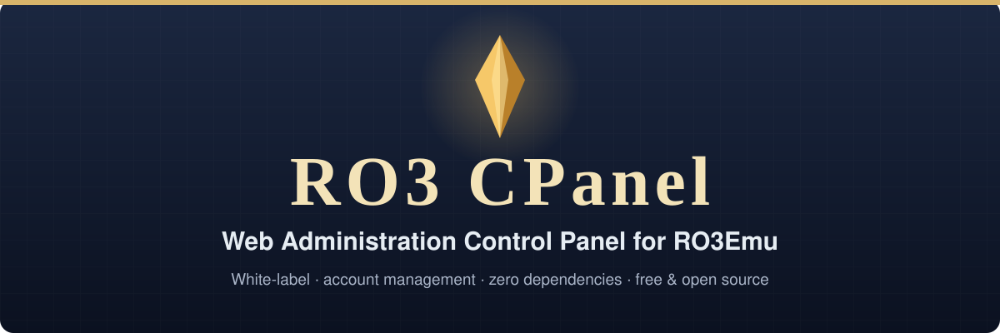

<p align="center">
  
</p>

<p align="center">
  <a href="#inicio-rápido-en-tres-pasos"></a>
  &nbsp;
  <a href="#por-qué-ro3-cpanel"></a>
  &nbsp;
  <a href="https://github.com/aethai/ro3emu-server"></a>
</p>

<p align="center">
  <a href="https://github.com/soyerno/ro3-cpanel/actions/workflows/ci.yml"></a>
  
  
  <a href="https://github.com/aethai/ro3emu-server"></a>
  <a href="LICENSE"></a>
</p>

Panel de administración (CPanel) moderno, ligero y personalizable con **marca blanca** para servidores privados de **Ragnarok Online 3 / Ragnarok Origin PC (`RO3Emu`)** ([aethai/ro3emu-server](https://github.com/aethai/ro3emu-server)).

Inspirado en los paneles clásicos de Ragnarok Online (FluxCP / CeresCP), desarrollado con una cuidada estética nórdica oscura, cero dependencias externas en Python y una interfaz SPA en vanilla JavaScript.

---

## Por qué RO3 CPanel

<table>
  <tr>
    <td width="50%" valign="top"><b>Marca blanca inmediata</b><br>Personaliza todo el panel para tu servidor privado en segundos. El título, subtítulo, logotipo y textos se configuran desde <code>config.json</code> o <code>.env</code> sin modificar el frontend.</td>
    <td width="50%" valign="top"><b>Cero dependencias externas</b><br>Funciona en Python 3.10+ estándar (<code>http.server</code>, <code>sqlite3</code>, <code>hashlib</code>). Sin <code>pip install</code>, sin Node.js, sin paquetes npm que auditar.</td>
  </tr>
  <tr>
    <td width="50%" valign="top"><b>Compatibilidad 1:1 con RO3Emu</b><br>El cálculo de contraseñas replica exactamente el algoritmo PBKDF2-SHA256 (100.000 iteraciones + sal de 16 bytes). Al suspender o cambiar claves, las sesiones del juego se revocan de inmediato.</td>
    <td width="50%" valign="top"><b>Gestión integral de cuentas</b><br>Buscador en tiempo real, fichas detalladas de personajes (Lv Base/Job, estadísticas, Zeny y otras monedas, coordenadas, inventario de solo lectura), creación de cuentas, reseteo de claves y auditoría.</td>
  </tr>
  <tr>
    <td colspan="2" valign="top"><b>Visor del registro de economía</b><br>Vista paginada y de solo lectura del libro <code>economy_entry</code> de RO3Emu unido a <code>operation_receipt</code> (el equivalente a los logs de zeny/pick de FluxCP) para auditar duplicaciones y disputas. Filtra por cuenta, personaje y rango de fechas UTC (<code>GET /api/admin/economy?account=&amp;character=&amp;from=AAAA-MM-DD&amp;to=AAAA-MM-DD&amp;page=&amp;page_size=</code>). Las consultas son parametrizadas y corren sobre una conexión <code>query_only</code>; si la base no tiene las tablas de economía responde <code>"available": false</code>.</td>
  </tr>
</table>

---

## Inicio rápido en tres pasos

| Paso | Acción |
|:---:|---|
| **1** | **Clona el repositorio:**<br><code>git clone https://github.com/soyerno/ro3-cpanel.git</code><br><code>cd ro3-cpanel</code> |
| **2** | **Configura tu servidor:**<br><code>cp config.example.json config.json</code><br>Indica la ruta hacia tu <code>ro3emu.db</code> y define tu usuario y contraseña de administrador.<br>Recomendado: ejecuta <code>python3 server.py --hash-password</code> y guarda el valor impreso como <code>password_hash</code> en lugar de una <code>password</code> en texto plano. El límite de intentos de login se ajusta con <code>login_max_failures</code> (por defecto 5) y <code>login_window_minutes</code> (por defecto 15). Consulta la <a href="docs/guide/security.md">guía de seguridad</a>. |
| **3** | **Inicia el panel:**<br>Windows: <code>run.cmd</code> &nbsp;·&nbsp; Linux: <code>./run.sh</code> &nbsp;·&nbsp; Docker: <code>docker compose up -d</code><br>Ingresa en tu navegador a <a href="http://localhost:8095">http://localhost:8095</a>. |

---

## Arquitectura e Integración

RO3 CPanel se ejecuta como un servicio autónomo conectado a la base de datos de `RO3Emu`:

```
[Navegador Web]
    │  (HTTP / HTTPS)
    ▼
[Nginx / Proxy Inverso] (Opcional)
    │  (Puerto 8095)
    ▼
[RO3 CPanel (server.py)]
    ├── Servidor SPA Integrado (public/index.html, admin.css, admin.js)
    ├── Endpoints REST API (/api/admin/*)
    ├── SQLite Concurrente (WAL) ──► [ro3emu.db]
    ├── Ping de Estado en Vivo  ──► [Servidor RO3Emu (Puerto 5380)] /ro3emu/status
    └── Diagnóstico             ──► [Servidor RO3Emu (Puerto 5380)] /ro3emu/online, /ro3emu/metrics (solo loopback)

    ├── Ping de Estado en Vivo  ──► [Servidor RO3Emu (Puerto 5380)]
    └── Herramientas GM (local) ──► [RO3Emu POST /ro3emu/gm]
```

### Jugadores en línea y métricas del servidor

El dashboard muestra el tiempo activo de RO3Emu, conexiones, jugadores en el mundo, memoria, sentencias de base de datos y contadores de errores, además de una tabla **En línea** (cuenta, personaje, mapa, posición). El panel los lee de `/ro3emu/metrics` y `/ro3emu/online` de RO3Emu, a través de `GET /api/admin/metrics` y `GET /api/admin/online`.

- **Solo loopback:** RO3Emu responde esos dos endpoints únicamente a pedidos desde `127.0.0.1` / `::1`. Ejecuta el panel en el mismo host que RO3Emu (o con un proxy hacia su loopback). Si no, el dashboard muestra "No disponible" y el resto del panel sigue funcionando.
- **URL base:** el panel obtiene la dirección de RO3Emu a partir de `ro3_status_url` (le quita `/ro3emu/status`). Define `ro3_base_url` (por ejemplo `http://127.0.0.1:5380`) para sobrescribirla.
- **IPs de jugadores:** RO3Emu informa la dirección remota de cada sesión. El panel la oculta salvo que `show_player_ips` sea el booleano JSON `true` (por defecto `false`).
- **Tiempo activo** es el tiempo desde que empezó la época de métricas de RO3Emu (inicio del proceso o el último `/ro3emu/metrics/reset`).
- Cada pedido mantiene el timeout de 2 s y tiene un tope de respuesta de 1 MB; cualquier fallo responde `200 {"available": false, "reason": "..."}`.

### Correo de personajes (solo lectura)

En la pantalla de la cuenta, **Ver correo** en la tarjeta de un personaje muestra su buzón, 10 cartas por página.
El panel nunca lo modifica. El endpoint es `GET /api/admin/characters/<role_id>/mail?page=1&page_size=20`
(requiere sesión de administrador; `page_size` va de 1 a 100, por defecto 20).

- RO3Emu no tiene tabla de correo: el correo de cada personaje vive en el BLOB `role.mailbox`, un documento JSON
  `MailService.Mailbox` (`NextId`, `Letters`). El panel lee solo esa columna, con `PRAGMA query_only = ON`, y lo decodifica en Python.
- Las cartas se ordenan de la más nueva a la más antigua (`CreatedTime` y luego `Id`, descendente), como las lista el juego.
- Cada correo devuelve `id`, `category`, `title`, `abstract`, `content`, `sender`, `sender_id`, `template_id`,
  `important_type`, `created_at` / `remove_at` (ISO 8601 UTC; `remove_at` es `null` si la carta no expira),
  `read`, `claimed`, `attachments` (`entry`, `count`, `bind`), `items` (`guid`, `entry`, `stack`), `currency` (`entry`, `amount`) y `attachment_count`.
  Las claves internas (`DeliveryKey`, `ContentParams`) y el blob crudo nunca se devuelven.
- Las cartas vencidas que el juego todavía no purgó siguen apareciendo; compara `remove_at` con la hora actual.
- Un buzón inexistente o vacío es una lista vacía. Un blob que no es JSON UTF-8 con esta forma devuelve `200` con
  `"decodable": false` y sin correos. Un id no numérico o cero devuelve `400`; un personaje inexistente o eliminado devuelve `404`.

### Herramientas GM

La pantalla de la cuenta incluye un panel **Herramientas GM** (teletransporte y desatascar) que envía comandos al
endpoint GM local de RO3Emu (`POST /ro3emu/gm?account=<cuenta>`). RO3Emu solo atiende ese endpoint por
loopback, así que **solo funciona si el panel corre en el mismo host que RO3Emu** (no desde otra máquina ni
desde un contenedor Docker en red bridge). Solo se envían los comandos listados en `gm_allowed_commands`
(por defecto `["warp"]`), el panel arma cada línea `!` a partir de números validados y cada intento queda en
el registro de auditoría. Ver [Arquitectura de Seguridad](docs/guide/security.md#5-gm-tools).

### Suspensión de cuentas

Suspender una cuenta requiere un RO3Emu con suspensiones de cuentas. El panel escribe la suspensión en la
tabla `account_ban` de RO3Emu, y RO3Emu rechaza el inicio de sesión de esa cuenta hasta que se quite la
suspensión. Las sesiones de juego de la cuenta se revocan en el acto. Una suspensión es permanente o dura 1, 7 o 30 días. Con un RO3Emu anterior (sin la tabla
`account_ban`) el panel no suspende y pide actualizar RO3Emu; nunca crea la tabla. Borrar una cuenta no levanta su
suspensión: RO3Emu sigue rechazando ese nombre si se vuelve a registrar.

Las cuentas suspendidas por una versión anterior del panel solo estaban marcadas en el panel y no se
trasladan: después de actualizar RO3Emu, vuelve a suspenderlas. Ver
[Arquitectura de Seguridad](docs/guide/security.md#account-bans).

---

## Inventario de Personajes

Cada tarjeta de personaje en la pantalla de la cuenta tiene un botón **Ver inventario** que lista los objetos del personaje agrupados por bolsa (`pack`: Objetos, Equipo, Cartas, Tótems, Emblemas, Monedas, Especial de clase). La vista es de solo lectura: el panel solo ejecuta consultas `SELECT` sobre la tabla `item`.

- API: `GET /api/admin/characters/<role_id>/items` (requiere sesión de administrador). Devuelve `{character, items, total, available}`; cada objeto incluye `guid`, `entry`, `name`, `stack`, `pack`, `pack_name`, `equipped`, `locked`, `bind_type`. `available` es `false` cuando la base todavía no tiene la tabla `item`.
- Los nombres de los objetos no se guardan en SQLite (viven en las tablas de configuración del servidor). Para mostrarlos, apunta `item_names_file` en `config.json` a un objeto JSON que relacione el id de configuración del objeto (`entry`) con su nombre:

  ```json
  { "100001": "Poción Roja", "200002": "Espada" }
  ```

  Déjalo vacío (`""`, valor por defecto) para desactivar los nombres. Si el archivo no existe o es inválido, se imprime una advertencia una sola vez en stderr y los objetos se muestran como `#<entry>`.

- Las imágenes y nombres más completos salen de un catálogo opcional. Apunta `item_catalog_file` a una lista JSON de filas `{"id": 5001, "n": "Poción Roja", "ic": "item_5001.png", "q": "Common"}` (`n` nombre, `ic` nombre del archivo del ícono, `q` una de Common, Fine, Rare, Legendary, Mythic; los demás campos se ignoran) y define `item_icons_url` con la carpeta del mismo sitio que sirve los íconos, por ejemplo `"/admin/item-icons/"`. Inventario, correo, baúl, mercado y premios de códigos de regalo devuelven entonces `name`, `icon` y `quality` por objeto. Los nombres de `item_names_file` siguen ganando sobre los del catálogo. Solo se aceptan nombres de ícono con la forma `[A-Za-z0-9_-]+.(png|webp|jpg)`, un `item_icons_url` que no sea una ruta simple del mismo sitio se ignora y, sin `item_icons_url`, el panel muestra los nombres sin imágenes.

### Selector de objetos

Cada vez que el panel pide un objeto (los premios de un código de regalo, el filtro de objeto de la pestaña Mercado) usa un único selector con autocompletado: escribe un nombre o un id, elige de una lista que muestra la imagen, el nombre y el id, y la elección queda como una ficha con un botón para quitarla. Es un combobox usable con teclado (flechas, Inicio/Fin, Enter para elegir, Escape para cerrar). La lista es la misma lista de objetos descrita arriba (`item_catalog_file` más `item_names_file`).

- **Endpoint de búsqueda**: `GET /api/admin/items/search?q=<texto>&limit=<n>` (requiere sesión de administrador) responde `{"available": true, "items": [{"entry", "name", "icon", "quality"}], "total": n}`. Busca una parte del nombre sin distinguir mayúsculas, o los dígitos de un id, ordenado primero por id exacto, luego nombres que empiezan con el texto y luego nombres que lo contienen. `limit` es 20 por defecto y tiene tope 50; `q` admite hasta 64 caracteres (400 si se pasa); un `q` vacío lista los primeros objetos por id. Sin lista de objetos responde `{"available": false, "items": [], "total": 0}` y el selector pasa a ser un campo numérico simple.
- **Validación**: con una lista de objetos configurada, `POST /api/admin/gift-codes` rechaza (400) un premio cuyo id no esté en la lista y nombra los ids. Sin lista se acepta cualquier entero positivo, como antes.
- **Filtro del mercado**: `GET /api/admin/market` acepta `entry=<entero positivo>` (id exacto del objeto, combinable con `q` y `status`); un valor que no sea un entero positivo es un 400.

## Eliminar un personaje

`POST /api/admin/characters/delete` con `{"role_id": 123, "confirm_name": "<nombre exacto del personaje>"}` hace un borrado lógico (`role.deleted_time`), el mismo que usa el borrado de cuenta; las filas siguen en la base. Está endurecido a propósito:

- Solo con sesión de administrador (se revisa contra `admin_users` en cada petición) y el cuerpo debe ser `application/json`, así un formulario de otro sitio no puede enviarlo.
- `confirm_name` debe ser igual al nombre del personaje, así un id equivocado nunca borra el personaje equivocado.
- No se pueden eliminar personajes de cuentas de administrador.
- La cuenta debe estar desconectada. Si RO3Emu no puede decir si está en línea, no se borra nada (HTTP 503) y una cuenta en línea responde HTTP 409.
- Como máximo `character_delete_max_per_minute` intentos por administrador (10 por defecto), válidos o no; al pasarse responde HTTP 429 con `Retry-After`.
- El borrado y su fila de auditoría (`delete_character`) se escriben en una sola transacción: no hay borrado sin registro de auditoría.

## Rankings

La pestaña **🏆 Rankings** muestra clasificaciones de solo lectura y paginadas. Los personajes eliminados (`deleted_time != 0`) siempre quedan excluidos.

```
GET /api/admin/rankings?type=level|zeny|power|guilds&limit=20&page=1
```

| `type` | Orden | `value` |
|---|---|---|
| `level` (por defecto) | Nivel base, luego nivel de job, luego EXP base | Nivel base |
| `zeny` | Zeny en posesión (ítem de moneda `1` en `role.currency`) | Cantidad de Zeny |
| `power` | Poder de leaderboard guardado por RO3Emu en `role.emblems` (`Power.CurrentNormal + Power.CurrentSeason`) | Poder total |
| `guilds` | Miembros activos, luego suma del nivel base de los miembros | Cantidad de miembros |

- `limit` vale `20` por defecto y se acota a `1..100`; `page` empieza en `1`. Cada fila incluye su `rank` global.
- Las filas de personajes incluyen `id`, `name`, `account`, `career`, `career_name`, `level` y `job_level`; las de clanes incluyen `id`, `name`, `member_count` y `total_level`.
- `power` lista solo personajes cuyo poder ya fue publicado al menos una vez por el servidor de juego; los blobs que no se pueden interpretar se omiten.
- `zeny` y `power` se decodifican en Python con una sola pasada sobre los personajes no eliminados (cargando solo las columnas necesarias), por lo que su costo crece con la cantidad de personajes.
- En bases sin las tablas `guild` / `guild_member`, `type=guilds` devuelve una lista vacía con `"available": false` en lugar de un error.
- Un `type` desconocido devuelve `400`. El endpoint requiere una sesión de administrador autenticada, igual que el resto de las lecturas `/api/admin/*`.

## Vistas de gremios y subastas (solo lectura)

Las pestañas **🛡️ Gremios** y **💰 Subastas** muestran datos de RO3Emu sin escribirlos nunca: cada consulta corre sobre una conexión con `PRAGMA query_only = ON` y todos los valores van como parámetros. Los listados están paginados (`page`, `page_size`; por defecto 50, máximo 200). Si la base no tiene esas tablas, los endpoints responden `200` con `"available": false`.

| Endpoint | Devuelve |
| --- | --- |
| `GET /api/admin/guilds?q=&page=&page_size=` | Gremios por id: `id`, `name`, `level`, `member_count`, `total_level`. `q` busca el texto literal en el nombre, sin distinguir mayúsculas. |
| `GET /api/admin/guilds/<id>` | El gremio y sus miembros: `role_id`, `name`, `account`, `career`, `career_name`, `level`. `404` si el gremio no existe. |
| `GET /api/admin/auctions?view=lots\|prebuy&page=&page_size=` | Más recientes primero. `lots` (`auction_item`): `id`, `source_key`, `settled`, `auction_type`, `run_id`, `end_time`. `prebuy` (`auction_prebuy`): `id`, `role_id`, `role_name`, `auction_type`, `src_type`, `item_id`, `quantity`, `unit_price`, `currency`, `processed`, `paused`. |

Solo se leen columnas relacionales, tal como las define `ro3emu-server` (`Accounts/Persistence/GuildStorePlans.cs`, `CoreSchemaPlans.cs`, `AuctionItemColumns.cs`). La única excepción es el `level` del gremio, que se lee del campo `Level` del JSON `guild.state` (`GuildStore.State`); vale `null` si el blob no se puede leer. Los conteos de miembros y la suma de niveles incluyen solo personajes no eliminados. Las columnas de `auction_item` que agregan migraciones posteriores de RO3Emu valen `null` en bases anteriores a ellas; valores como `auction_type` y `end_time` se muestran tal como están guardados.

---

## Guías de Documentación

- [Guía de Alojamiento y Despliegue](docs/guide/hosting.md) (Tareas programadas de Windows, Linux systemd, Docker, Nginx, Cloudflare)
- [Guía de Personalización de Marca Blanca](docs/guide/white-label.md) (Temas, textos, logotipo y rutas)
- [Pantalla de cuenta](docs/guide/account-screen.md) (Gestionar una cuenta en su propia pantalla: personajes, bóveda, seguridad y moderación)
- [Bóveda de cuenta y mercado web](docs/guide/vault-market.md) (Vistas de solo lectura de la bóveda y el mercado del portal web)
- [Códigos de regalo](docs/guide/gift-codes.md) (Crear y administrar códigos canjeables desde el panel)
- [Idioma](docs/guide/language.md) (inglés por defecto, traducción al español, cambio desde el panel)
- [Nombres de Clases y Mapas](docs/guide/names.md) (Nombres de clases y mapas, archivo `names_file` personalizado)
- [Arquitectura de Seguridad](docs/guide/security.md) (Hashes PBKDF2, cookies HttpOnly, registro de auditoría)
- [Guía de Pruebas Automatizadas](docs/guide/testing.md) (Ejecución del test suite con unittest)

---

## Proyectos Relacionados

- **[ro3emu-server](https://github.com/aethai/ro3emu-server)** — Emulador de servidor open-source para Ragnarok Online 3.
- **[ro3-emu-launcher](https://github.com/soyerno/ro3-emu-launcher)** — Lanzador de escritorio y auto-parcheador para servidores RO3Emu.

---

## Contribuir

¡Las contribuciones son bienvenidas! Consulta [AGENTS.md](AGENTS.md) y [CONTRIBUTING.md](CONTRIBUTING.md) para conocer las pautas de estilo, la regla de cero dependencias y el flujo de Pull Requests.

---

## Licencia

Distribuido bajo la [Licencia MIT](LICENSE).
